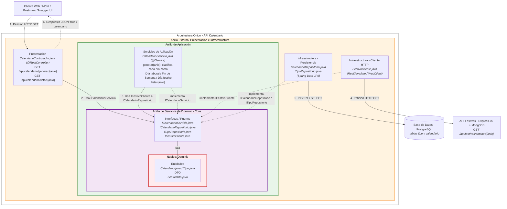
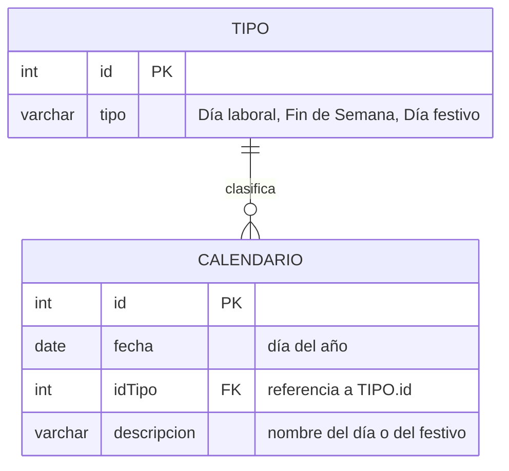

# Punto 2 – API RESTful Calendario (Spring Boot + PostgreSQL)

**Integrantes:**
- Sebastian Restrepo Mira
- Vanessa Espinosa Cardona
- Eric David Florez Vasquez
- Mateo Mesa Cardona

## Endpoints que expone la API

| Método | Ruta | Respuesta |
|---|---|---|
| GET | `/api/calendario/generar/{anio}` | `true` si se clasificaron y guardaron todos los días del año |
| GET | `/api/calendario/listar/{anio}` | JSON: `[{ "id": 1, "fecha": "2023-01-01", "tipo": { "id": 3, "tipo": "Día festivo" }, "descripcion": "Domingo" }, ...]` |

## Endpoint que consume de la API Festivos (punto 1)

| Método | Ruta | Uso |
|---|---|---|
| GET | `/api/festivos/obtener/{anio}` | Obtener la lista de festivos del año para clasificar los días |

---

## 1. Diagrama de Arquitectura Onion

En la arquitectura Onion las capas son anillos concéntricos y **todas las dependencias apuntan hacia el centro**. El dominio no depende de nada. El núcleo define interfaces (puertos) y la infraestructura las implementa (inversión de dependencias). La base de datos y la API Festivos quedan afuera, como detalles reemplazables.

> El paso 4 (llamada a la API Festivos) solo ocurre en `generar`. En `listar` el servicio solo consulta el repositorio.

### Regla de dependencias

| Anillo | Contiene | Depende de |
|---|---|---|
| Núcleo: Dominio | Entidades `Calendario`, `Tipo` y DTO `FestivoDto` | Nada |
| Servicios de Dominio (Core) | Interfaces `ICalendarioServicio`, `ICalendarioRepositorio`, `ITipoRepositorio`, `IFestivoCliente` | Dominio |
| Aplicación | `CalendarioServicio` (lógica de clasificación de días) | Core y Dominio |
| Externo: Presentación e Infraestructura | `CalendarioControlador`, repositorios JPA, `FestivoCliente` | Anillos internos (implementa sus interfaces) |

---

## 2. Diagrama de la Base de Datos (PostgreSQL)

Modelo relacional del taller: cada registro de `calendario` es un día del año y está clasificado por un `tipo`.

### Datos de la tabla `tipo`

| id | tipo |
|---|---|
| 1 | Día laboral |
| 2 | Fin de Semana |
| 3 | Día festivo |
